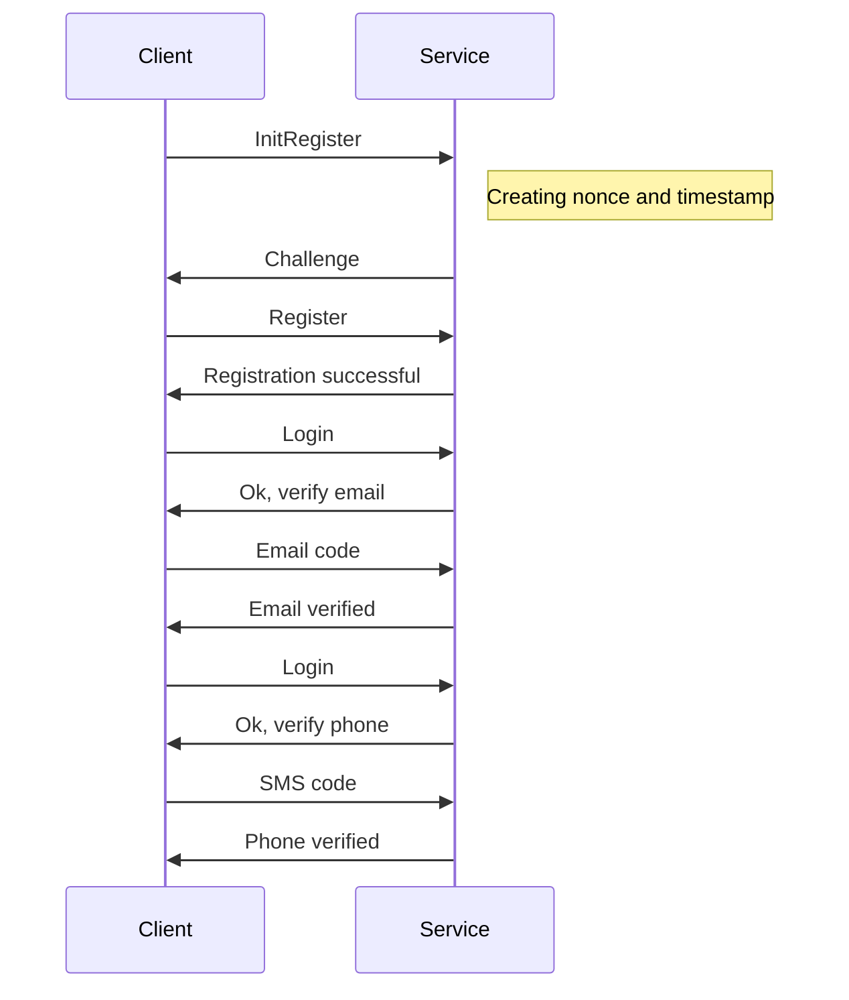
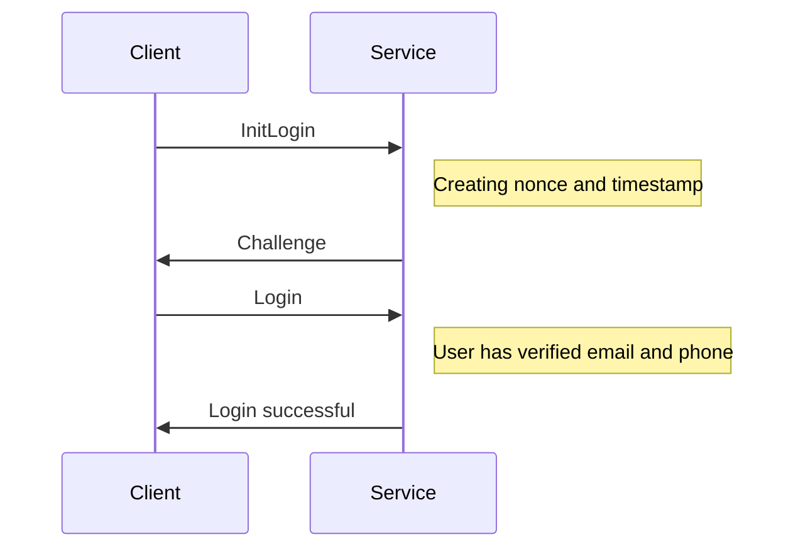
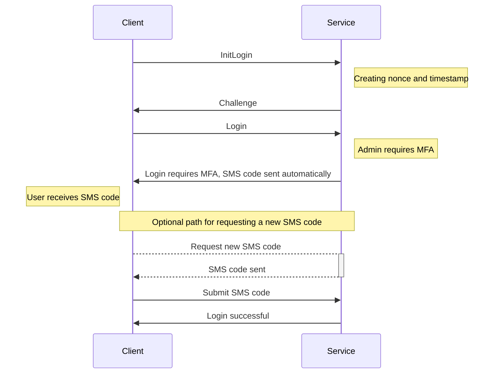

# ISECure Python Client — Beta

This is a client side SDK for interacting with ISECure banking file exchange REST API.

**Status: Beta.**

> The OpenAPI specification for the REST API service this client interacts with is in the linked [wsapi_v2.json](https://www.isecure.fi/wsapi_v2.json) file.

## Install from GitHub

Use Python 3.10–3.12. The current PGP dependency does not support Python 3.13+.

```sh
python -m pip install "isecure-client @ git+https://github.com/isecurefi/isecure-py-client.git"
```

Version 0.1.1 is available from the GitHub release as a wheel and source archive,
or install the tagged source with `@v0.1.1`. This repository does not establish a PyPI release.

## Current coverage

The client implements registration, challenge-response login, SMS MFA, phone/email
verification, PGP key upload, file upload and file listing, plus local PGP signing
and verification. It is synchronous and uses an interaction handler for prompts.
It does not yet match the TypeScript SDK: TOTP enrollment/factor selection,
certificate operations, file download/deletion, account administration and logout
are not implemented. See the [TypeScript SDK](https://github.com/isecurefi/isecure-ts-client)
for broader API coverage. The specific login and inline UploadFile flow was verified
against gpgtest; see [verification notes](docs/inline-upload-review.md). No real-bank
production qualification is claimed.

## Example

See [examples/full_workflow.py](examples/full_workflow.py). It performs registration,
PGP key upload and file upload against the test API; running it changes that account.
Set `ISECURE_API_KEY`, `ISECURE_COMPANY`, `ISECURE_NAME`, `ISECURE_PASSWORD`,
`ISECURE_PHONE` and `ISECURE_EMAIL` in your environment. Use your verified tenant API
key for an existing tenant. The initial owner registration can use `0`; reuse the
returned API key for subsequent registrations.

Set `ISECURE_PGP_PUBLIC_KEY_FILE` and `ISECURE_PGP_PRIVATE_KEY_FILE` to your own
local PGP key files. No private keys or account credentials are distributed.
`test.pem` and `prod.pem` are the API's public RSA encryption keys, not private keys.
Never commit your credentials or private keys. Test access and bank connections
must be provisioned separately; registration does not grant paid product access.

## Inline upload reports

`upload_file` returns the bank's response dictionary, including optional Base64
`Content` when a bank returns a report directly from UploadFile:

```python
response = client.upload_file(encoded_query, "balance-query.xml", "camt.060.001.02", signature)
if response.get("ResponseCode") == "00" and "Content" in response:
    report = base64.b64decode(response["Content"], validate=True)
```

Import `base64` before using the example. The bank's query and signing requirements
still apply. Ordinary acknowledgements omit `Content`. The SDK preserves the raw
encoded field and makes no follow-up download request. HTTP failures continue to
raise exceptions. Calls that previously ignored the return value remain valid;
code explicitly expecting `None` should use the returned dictionary instead.

## Development

```sh
python -m venv .venv
. .venv/bin/activate
python -m pip install -e ".[dev]"
python -m pytest
```

Tests generate disposable PGP keys in memory and make no bank API calls.

## License

MIT; see [LICENSE](LICENSE).

## APPENDIX: Message Sequence Charts

### Registering User Example

Example for registering to ISECure SaaS Bank API service test environment.



### Login Example (Data User)

Example of login flow for a data user when both email and phone are already verified.



### Login Example (Admin User with MFA)

Example of login flow for an admin user requiring MFA with SMS verification.




## Opt-in password profile (unpublished preview)

Owner scope (2026-11-08): draft and local testing only. This work does not
authorize server deployment, tenant-policy activation or SDK publication.

This source adds `password-rsa-oaep-sha256-v1` on existing v2 routes. Availability
is environment-specific: the SDK requires matching server discovery and never
falls back if an older server ignores the selector. Existing configuration keeps
the legacy profile. After server policy activation, new tenants must select the
new profile; grandfathered tenants can use either profile, including new accounts.

```python
from isecure_client import ISECureClient, PASSWORD_ENCRYPTION_PROFILE
client = ISECureClient(**settings, encryption_profile=PASSWORD_ENCRYPTION_PROFILE)
registration = client.register()  # returns and adopts the tenant API key
client.init_password_reset()
client.reset_password(recovery_code, new_password)
```

The profile uses direct RSA-3072/4096 OAEP with SHA-256/MGF1-SHA-256 and an empty
label. The binary envelope binds the exact challenge and preserves 1–283 UTF-8
password bytes without normalization. Discovery is not authorization. Admin MFA
still applies. Do not log password envelopes, tokens, codes or raw auth bodies.
Reset uses its own discovery; never substitute an InitLogin challenge or
automatically retry code delivery/password mutation. This preview is not a
production availability or NIST/FIPS certification claim.
